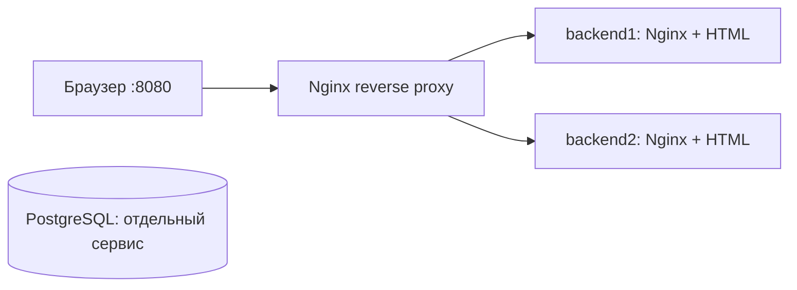

# Full-stack Lab

**Учебный стенд: Docker Compose, Nginx и распределение HTTP-запросов.**

`Docker Compose` · `Nginx` · `PostgreSQL`

[Портфолио автора](https://github.com/obnqo40) · [Схема](#схема) · [Запуск](#запуск) · [Границы стенда](#границы-стенда)

## Задача

На небольшом примере разобраться, как контейнеры общаются по именам сервисов, как Nginx направляет запросы через upstream и как несколько сервисов описываются в одном Compose-файле.

## Схема



`backend1` и `backend2` — два Nginx-контейнера со статическими страницами **Backend 1** и **Backend 2**. Внешний Nginx использует их как upstream. PostgreSQL включён в окружение, но страницы к нему не обращаются.

## Запуск

Нужны Docker Engine или Docker Desktop с поддержкой Compose. Выполните из каталога репозитория:

```bash
docker compose config --quiet
docker compose up -d
```

Откройте [http://localhost:8080](http://localhost:8080). При последовательных запросах к upstream можно увидеть ответы обеих страниц:

```bash
curl http://localhost:8080
```

Посмотреть состояние и журналы:

```bash
docker compose ps
docker compose logs nginx
```

Остановить стенд:

```bash
docker compose down
```

## Файлы

| Файл | Назначение |
| :--- | :--- |
| [`compose.yaml`](compose.yaml) | Четыре сервиса и монтирование конфигурации/страниц |
| [`nginx.conf`](nginx.conf) | Upstream и reverse proxy |
| [`backend1/index.html`](backend1/index.html) | Ответ первого контейнера |
| [`backend2/index.html`](backend2/index.html) | Ответ второго контейнера |

## Границы стенда

- Это лаборатория маршрутизации, а не backend-приложение с бизнес-логикой.
- В Compose указаны учебные реквизиты PostgreSQL; они не подходят для внешнего развёртывания.
- Образы не закреплены по версии. У официального PostgreSQL требования к тому с данными зависят от версии; воспроизводимость нужно отдельно обеспечить перед развитием стенда.
- Именованный том и процедура резервного копирования PostgreSQL не настроены. Сохранность данных после пересоздания окружения не гарантируется.
- В конфигурации нет TLS, healthcheck и наблюдаемости; порядок готовности сервисов отдельно не задан.

Следующее развитие: закрепить версии, настроить том PostgreSQL, добавить healthcheck и подключить небольшой API к базе.
